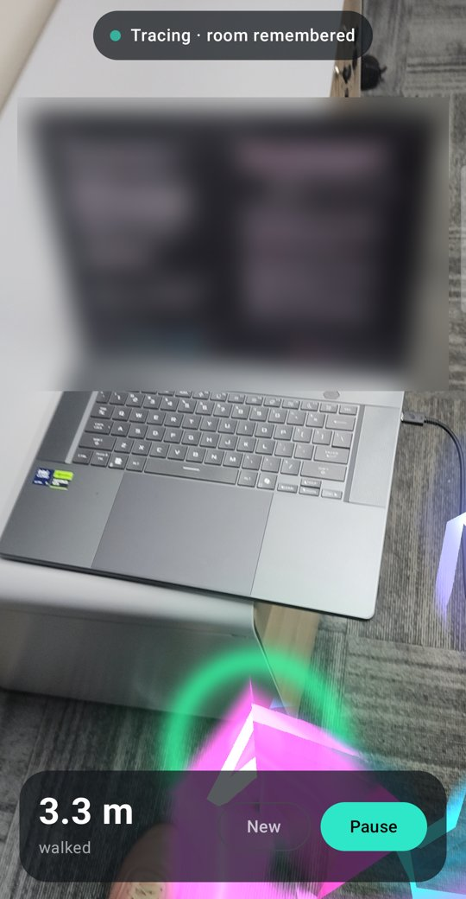
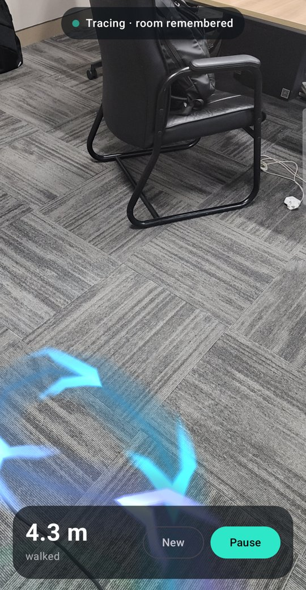

# Path Tracer

**Find your way inside big buildings.** Path Tracer is a native Android augmented-reality app. Record the walk from a building's entrance to a room, share it with a friend, and their phone guides them there with arrows on the floor, through elevators, stairs and escalators.

It also has a free-trail mode that draws a glowing trail on the floor behind you and brings it back on your next visit.

<p align="center">
  
  &nbsp;&nbsp;
  
</p>
<p align="center"><sub>Left: tracing a path from the start beacon. Right: the same trail restored after the app was closed and reopened.</sub></p>

## Features

### Routes: record, share, follow

- **Start from a photo.** At the entrance, photograph something flat and detailed: the building sign, a poster, a door plate. That photo is how a friend's phone knows where the route begins.
- **Record by walking.** Walk to the destination. Tap **Floor change** at an elevator, stairs or an escalator, and **Arrived** at the end.
- **Elevators.** Tracking breaks inside a moving lift, so after the ride you photograph a sign near the elevator (like the floor number) and carry on.
- **Checkpoints.** On long routes, photograph a sign along the way. When a follower's camera sees it, the route snaps back into place, which cancels drift.
- **Share as a file.** A route is one small `.pathroute` file. Send it on WhatsApp, email or anything else. It opens in Path Tracer.
- **Follow in AR.** Point the camera at the entrance photo and the route appears. Only the next few meters show, as arrows flowing the way to walk. Turns get a big arrow on the floor and a card like "Turn left in 4 m". The phone buzzes before each turn.
- **Never lost.** If the path is off screen, a big arrow tells you to turn left, right or around. Walk off the route and it points you back.
- **Works offline.** Photos are recognised on the phone with ARCore Augmented Images. No account, no server.

### Free trail

- **Live floor trail.** An animated ribbon follows you across the floor. Chevrons flow from the start toward where you are now, and the colour shifts from cyan (oldest) to magenta (newest).
- **Start beacon.** A pulsing marker shows where the walk began.
- **Room memory.** The trail is saved on the phone and anchored to the room, so it comes back on your next visit. You can keep walking to extend it.
- **Two ways to recognise the room.** Use a printed marker (offline, no account) or Google Cloud Anchors (no marker, needs internet).
- **Distance walked**, plus pause, resume and start-over controls.

## How it works

ARCore tracks the phone's position from the camera and motion sensors, and detects the floor. While you walk, the app projects your position onto the floor about every 12 cm and stores each point relative to a **start anchor**. That anchor is what makes the trail persistent. If the app can find the anchor again later, every stored point lands back in the same physical spot.

The app finds the start anchor again in one of two ways:

| Mode | How it recognises the room | Needs |
| --- | --- | --- |
| **Marker · offline** (default) | [ARCore Augmented Images](https://developers.google.com/ar/develop/augmented-images) recognises the `START HERE` picture | A printed or on-screen copy of [`start_marker_print_me.png`](start_marker_print_me.png). No account or internet. |
| **Cloud** | [ARCore Cloud Anchors](https://developers.google.com/ar/develop/cloud-anchors) match what the camera sees against a saved visual map of the start spot (kept for up to 365 days) | Internet and a one-time Google Cloud setup ([below](#cloud-mode-setup)) |

The marker can lie on the floor, hang on a wall, or be shown on a monitor. The app keeps only the marker's heading, so the trail stays level either way.

## Getting started

### Requirements

- An [ARCore-supported Android phone](https://developers.google.com/ar/devices) running Android 7.0 or later. The app prompts you to install Google Play Services for AR if it's missing. Emulators can't run it in any useful way.
- JDK 17 or newer and the Android SDK (API 36), or Android Studio.

### Build and install

```bash
git clone https://github.com/Aurumdev952/path-tracer.git
cd path-tracer
./gradlew installDebug
```

Or open the folder in Android Studio and press **Run**.

### Record a route

1. Open **Path Tracer**, tap **Record a new route** and allow camera access.
2. At the entrance, fit a sign, poster or door plate in the white box and tap the button. Move the phone slowly from side to side until it locks on.
3. Walk to the destination.
   - At an **elevator**: tap **Floor change → Elevator**, ride, then photograph a sign near the elevator when you step out.
   - On **stairs or an escalator**: tap **Floor change** and pick it. Keep walking.
   - On a long walk: tap **Checkpoint** now and then and photograph a sign.
4. Tap **Arrived** and give the route a name.

### Follow a route

1. On the home screen tap **Share** on a route and send the file. Your friend opens it (or uses **Open route file**).
2. They tap **Follow**, go to the entrance and point the camera at the sign in the photo.
3. They follow the arrows. After an elevator ride, the app shows which sign to point at next.

Good photos: flat, matte, lots of detail (text, logos, pictures), not too small in the box. Plain walls, glass and shiny screens don't work.

### Free trail

1. On the home screen tap **Free trail** and allow camera access.
2. Choose a mode at the top of the screen.
   - **Marker:** place the `START HERE` marker where you begin (print it on A4, or show it full-screen on a monitor) and point the camera at it from about 0.5 to 1 m away.
   - **Cloud:** point the camera at the floor where you're standing.
3. When the status reads **Tracing**, walk. Turn around to see your path.
4. Close the app whenever you like. Next time, point at the marker (or look around the start spot in Cloud mode) and the trail comes back.

**Pause** stops recording, and **New** discards the trail and starts over.

## Cloud mode setup

Cloud mode uses ARCore's [keyless authorization](https://developers.google.com/ar/develop/authorization), so no API key is stored in the app.

1. In the [Google Cloud console](https://console.cloud.google.com/), create a project and enable the **ARCore API**.
2. Under **APIs & Services → Credentials**, create an **OAuth client ID** of type **Android**.
   - Package name: `rw.aurum.pathtracer`
   - SHA-1: your signing certificate fingerprint. For debug builds, get it with:

     ```bash
     keytool -list -v -keystore ~/.android/debug.keystore -alias androiddebugkey -storepass android | grep SHA1
     ```

3. Configure the OAuth consent screen if the console asks.

Until this is set up, Cloud mode still traces live, but the status shows **not saved** and the trail won't come back later.

## Project structure

```
app/src/main/java/rw/aurum/pathtracer/
├── HomeActivity.kt        Route list, share, import, links to the other screens
├── ArActivity.kt          Shared base: permissions, ARCore session, camera view
├── ArRenderer.kt          Shared GL frame loop and event queue
├── RecordActivity.kt      Recording screen
├── RouteRecorder.kt       Recording: photos, locking on, legs, floor changes
├── SignPhoto.kt           Cuts the framed sign out of ARCore's camera image
├── FollowActivity.kt      Following screen: instruction card, look-here arrow, arrival
├── RouteFollower.kt       Following: finds the photos, snaps the route, guides
├── GuideRenderer.kt       OpenGL ES path, turn arrow and goal marker
├── Guide.kt               Pure logic: route stretches, turn detection, progress, instructions
├── Route.kt               Route data model and JSON format
├── RouteStore.kt          Routes on disk, .pathroute export and import
├── YawPose.kt, ArPoses.kt Upright poses, floor height
├── TrailActivity.kt       Free-trail screen
├── PathTracer.kt          Free trail: finding the start, recording, cloud host/resolve
├── Trail.kt               Free-trail data model and JSON storage
├── TrailRenderer.kt       OpenGL ES ribbon and start-beacon shaders
└── BackgroundRenderer.kt  Camera image rendering
app/src/main/assets/start_marker.png   The marker image ARCore looks for
```

All AR state lives on the GL render thread. The UI and ARCore callbacks send events to that thread through a queue, and the thread publishes one UI state object back to Compose.

A route is a list of **legs**. Each leg starts at a photo, and its points are stored in that photo's frame (levelled, so up is up). A leg begins at the entrance, after an elevator, or at a checkpoint. A checkpoint also stores where it sits relative to the previous leg, so legs joined by checkpoints are followed as one continuous **stretch**. Seeing any photo of a stretch re-anchors the whole stretch. Elevators start a new stretch.

Run the logic tests with `./gradlew testDebugUnitTest`.

## Built with

- [ARCore](https://developers.google.com/ar) 1.56: motion tracking, plane detection, Augmented Images, Cloud Anchors
- Kotlin and [Jetpack Compose](https://developer.android.com/compose) (Material 3)
- OpenGL ES 2.0 with custom shaders

## Limitations

- The path is drawn on top of everything, so walls and furniture don't hide it yet. Follow mode limits this by only showing the next 7 m.
- Free trail keeps one trail at a time and assumes one floor level.
- Accuracy depends on ARCore tracking. Fast motion, low light and blank walls cause drift. Use checkpoints on long routes.
- Photos must be of flat things. A sign that looks the same on every floor can be confused; pick ones that differ (like the floor number).

## Ideas for next steps

- Hide the path behind real objects with the ARCore Depth API.
- Spoken directions.
- Recognise a room offline with no marker, using an open-source mapping library such as [RTAB-Map](https://introlab.github.io/rtabmap/).

## Troubleshooting

**The Gradle build hangs and never finishes.** On some Linux setups the JVM's process-reaper thread overflows its stack, so Gradle never sees child processes such as `jlink` exit. `gradle.properties` already passes `-Djdk.lang.processReaperUseDefaultStackSize=true` to the Gradle daemon. If the launcher itself still hangs, also run:

```bash
export JAVA_OPTS="-Djdk.lang.processReaperUseDefaultStackSize=true"
```

**The marker isn't recognised.** Make it bigger in the camera view, cut glare and reflections, and keep the camera still for a second. A matte print works best.

## License

[MIT](LICENSE)
